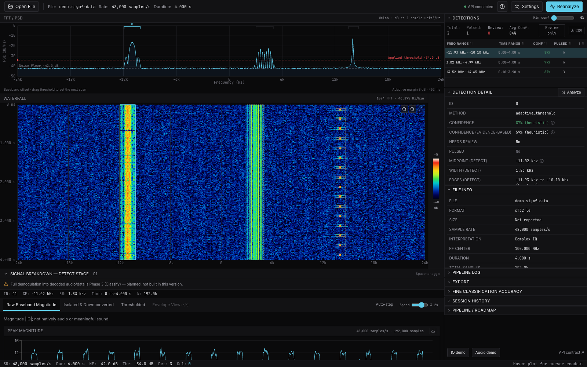
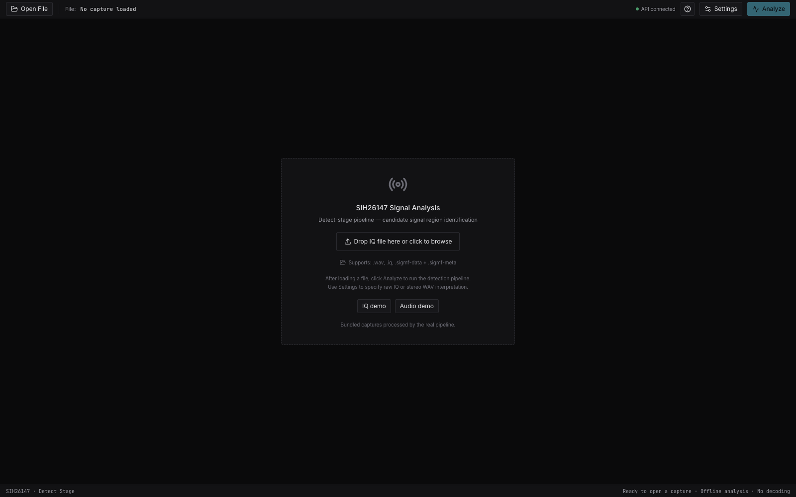
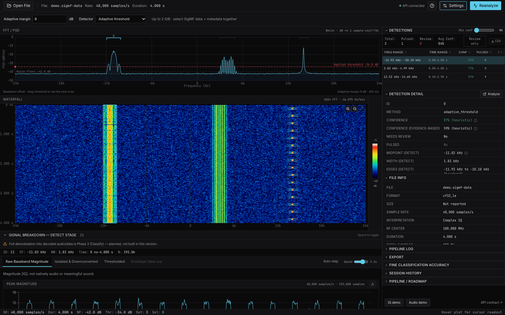
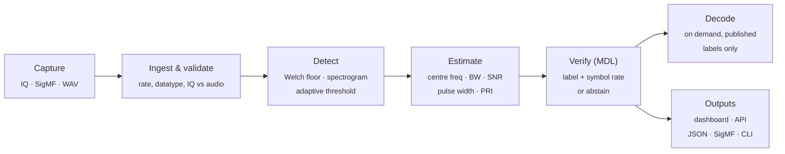
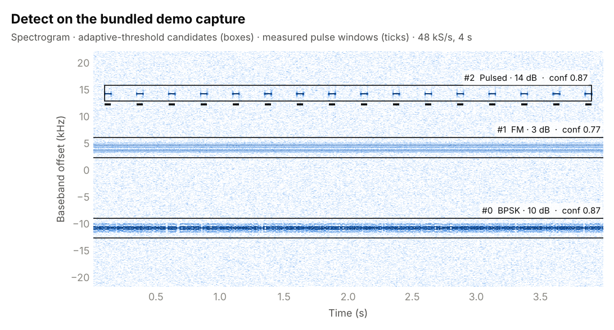
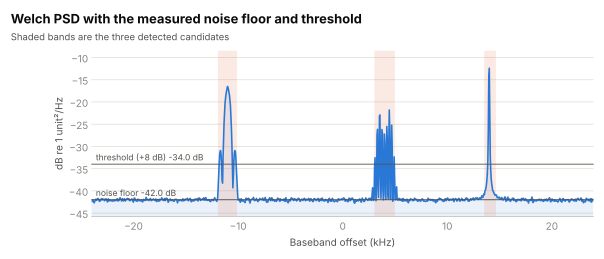
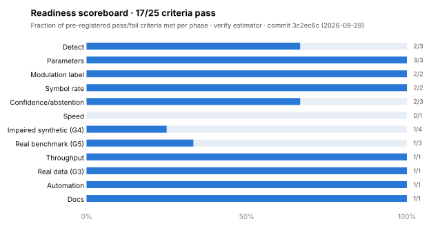
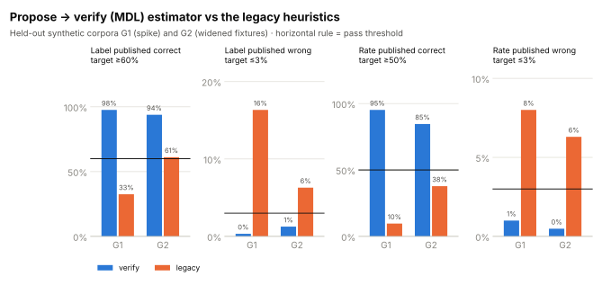
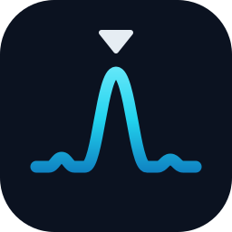

<p align="center">
  <picture>
    <source media="(prefers-color-scheme: dark)" srcset="docs/assets/brand/pinpoint-banner-dark.svg">
    
  </picture>
</p>

<p align="center">
  <b>Find where a signal is, measure what it is, and say so only when the evidence holds.</b><br>
  An offline RF capture detector and analysis dashboard, built for Smart India Hackathon problem <b>SIH26147</b> (NTRO, software track).
</p>

<p align="center">
  <a href="https://github.com/pranshu1141-sharma/Pinpoint/actions/workflows/tests.yml"></a>
  
  
  
  
  
  <a href="https://github.com/pranshu1141-sharma/Pinpoint/releases/tag/v0.1.0-beta.1"></a>
</p>

<p align="center">
  <a href="#quick-start">Quick start</a> ·
  <a href="#how-it-works">How it works</a> ·
  <a href="#measured-results">Results</a> ·
  <a href="#command-line">CLI</a> ·
  <a href="#reference">Reference</a> ·
  <a href="docs/README.md">Docs</a>
</p>

---

PinPoint takes a raw capture (complex IQ, SigMF or WAV), finds candidate regions in time and frequency, measures pulse timing and per-candidate parameters (centre frequency, −3 dB / 99 % bandwidth, SNR), and **estimates modulation label and symbol rate for each IQ candidate** in synchronous uploads, demos, async large uploads, the API, the detail table and JSON export. A label or rate is published only when its margin passes a threshold fit on a cross-generator calibration split; otherwise the output says *unknown family* or *not reliably estimated*.

> [!NOTE]
> Everything is validated on synthetic generators only; see the measured [readiness scoreboard](docs/READINESS.md) and the conditioned [claims table](docs/CLAIMS.md). No FM/AM demodulation exists. On-demand symbol/bit recovery (`POST /api/detections/{job_id}/{id}/decode`, the dashboard's Decode screen) runs only for a candidate whose verify label is a published BPSK/QPSK/8PSK/FSK2/ASK2, and returns a stream that is correct only up to an unknown rotation/polarity and start offset — no framing or message decoding, synthetic-validated only ([DECODING.md](DECODING.md)). See [integration verification](docs/INTEGRATION_VALIDATION.md).

## Highlights

| Capability | What it does |
|---|---|
| **Blind detection** | Welch noise floor + adaptive CFAR-style threshold over a 1,024-point spectrogram; candidates carry time/frequency extents and individual pulse windows. |
| **Parameter estimation** | Centre frequency, −3 dB and 99 % occupied bandwidth, SNR, pulse width and PRI — every value in honest units (dB re 1 unit²/Hz, never dBm). |
| **Modulation & symbol rate** | A propose → verify (MDL) estimator that rebuilds each segment under competing hypotheses and abstains unless the winner clearly beats every rival. |
| **Large captures** | 1–2 GiB uploads scanned in bounded memory: disk-backed reads, 524,288-sample blocks, background jobs with real progress. |
| **Inspectable evidence** | Signal Breakdown layers, PSD / waterfall views, a replayed pipeline log, and JSON / SigMF export with validated annotations. |
| **Batch & terminal** | `pinpoint analyze / watch / summary / validate` — deterministic, parallel, and pipe-friendly (`--json`). |

## The dashboard

The dashboard runs the bundled IQ capture through the real Detect pipeline and keeps the complete investigation workflow in one offline workspace.

<p align="center">
  
</p>
<p align="center"><em>Detect workspace: PSD, adaptive threshold, waterfall, candidate list, confidence and signal breakdown.</em></p>

<table>
  <tr>
    <td width="50%"></td>
    <td width="50%"></td>
  </tr>
  <tr>
    <td align="center"><em>Capture intake: open IQ, WAV or SigMF data, or launch a bundled demo.</em></td>
    <td align="center"><em>Detector controls: tune adaptive margin and switch between adaptive and fixed-debug analysis.</em></td>
  </tr>
</table>

## How it works



Here is the detector on the bundled demo capture (`backend/data/demo/`): a 10 dB BPSK carrier, a 3 dB FM signal and a 14 dB pulse train in 4 s of 48 kS/s IQ. All three are found; the pulsed candidate carries its 16 measured burst windows.

<picture>
  <source media="(prefers-color-scheme: dark)" srcset="docs/assets/charts/demo-waterfall-dark.png">
  
</picture>

<picture>
  <source media="(prefers-color-scheme: dark)" srcset="docs/assets/charts/demo-psd-dark.svg">
  
</picture>

<sub>Both figures are rendered from a real pipeline run by <code>python -m experiments.readme_figures</code>.</sub>

## Measured results

Pre-registered pass/fail criteria, scored on held-out seeds by `python -m experiments.readiness.scoreboard`. G1 = spike corpus, G2 = widened shipped fixtures, G3 = public recordings, G4 = impaired synthetic, G5 = real benchmark. Full table with sample sizes: [docs/READINESS.md](docs/READINESS.md); every number with its conditions: [docs/CLAIMS.md](docs/CLAIMS.md).

<picture>
  <source media="(prefers-color-scheme: dark)" srcset="docs/assets/charts/readiness-dark.svg">
  
</picture>

The verify estimator against the older fixture-validated heuristics on the same corpora — it publishes far more correct labels and rates while keeping wrong ones under the 3 % ceiling:

<picture>
  <source media="(prefers-color-scheme: dark)" srcset="docs/assets/charts/estimator-compare-dark.svg">
  
</picture>

> [!IMPORTANT]
> The open gaps are real: impaired synthetic captures (G4) and the real benchmark (G5) do not yet meet their label criteria, and speed misses its target on G2. These are tracked in [docs/LIMITATIONS_AND_ROADMAP.md](docs/LIMITATIONS_AND_ROADMAP.md).

## Quick start

Requirements: Python 3.12–3.13, Node.js 22.18+ (20.19+ builds and runs the dashboard; the frontend tests need 22.18+ to run `.ts` files directly), and npm. Tested here with Python 3.13 and Node 24. macOS's system `python3` is 3.9 and will not work; use e.g. `python3.13`.

```bash
python3.13 -m venv .venv                                  # python3.12 also works
.venv/bin/python --version                                # must print 3.12 or 3.13
.venv/bin/python -m pip install -r backend/requirements-lock.txt
npm --prefix frontend ci
```

Then run the two servers in separate terminals from the project root:

```bash
# terminal 1 — API
.venv/bin/python -m uvicorn backend.api.main:app --host 127.0.0.1 --port 8000

# terminal 2 — dashboard
npm --prefix frontend run dev
```

Open [the dashboard](http://127.0.0.1:5173/) and [the interactive API contract](http://127.0.0.1:8000/docs). On Windows use `.\.venv\Scripts\python.exe` in place of `.venv/bin/python`. The Vite server proxies `/api` to FastAPI. `npm --prefix frontend run build` checks TypeScript and creates the frontend production bundle; it does not bundle the Python server. This is a local full-stack deliverable, not a standalone hosted frontend.

The dashboard opens on a capture-intake screen. **IQ demo** runs the bundled `backend/data/demo/demo.sigmf-data` (with its metadata) and **Audio demo** the bundled `audio_demo.wav`, through the same analysis pipeline used for uploads; nothing is generated in the frontend. Results export as JSON or SigMF (`/api/export/{job_id}`) or as CSV from the detections list. If port 8000 is taken, start the API on another port and run the dashboard with `PINPOINT_API_URL=http://127.0.0.1:<port> npm --prefix frontend run dev`. If the build reports missing modules after pulling new commits, rerun `npm --prefix frontend ci`. Fonts are bundled for offline use after installation. If FastAPI is unavailable the dashboard shows **Not connected** and hides computed result panels.

### Generate and verify

```bash
.venv/bin/python -m backend.pipeline.synth_gen     # synthetic fixtures + ground truth
.venv/bin/python -m pytest backend/tests -q        # backend test suite
.venv/bin/python -m backend.validate               # validation report
npm --prefix frontend run build && npm --prefix frontend test
```

CI (`.github/workflows/tests.yml`) installs `backend/requirements-lock.txt` and runs the backend tests on Python 3.12 and 3.13 (the lock's numpy 2.5.3 / scipy 1.18.1 need 3.12+), and runs the frontend build and tests on Node 24, for every push and pull request.

The generator writes continuous BPSK, QPSK, and FM at 20, 10, 0, and −5 dB SNR, an eight-pulse capture, pure noise, a mixed demo, and an audio WAV under `backend/data/generated/`. Ground truth is stored in separate `.truth.json` files. The detector never reads ground truth. SNR is total signal power divided by full-band complex noise power; pulsed SNR is measured during the pulse. This differs from narrowband receiver SNR.

The included suite checks detection recall and frequency/time bounds for all 12 continuous fixtures; pulse width, PRI and pulse count; ten independent noise seeds; a 40 dB input-amplitude power shift; agreement with the fixed-threshold debug detector; 20–300 ms isolated bursts with no invented PRI; continuous signals not mislabeled as pulses; malformed input; WAV ambiguity; real upload/API/clip contracts; bounded spectrogram dimensions; and validated SigMF export. See `backend/validation-report.json` for measurements from an actual pipeline run. These are synthetic checks, not field-performance claims or proof of a specified probability of false alarm.

## Command line

```bash
pip install -e .           # core: numpy, scipy, sigmf
pip install -e ".[server]" # + FastAPI/uvicorn, if you also want the dashboard API
```

| Command | What it does |
|---|---|
| `pinpoint analyze captures/ --out results/` | Analyse a file or folder; one JSON + SigMF meta per file plus `summary.csv`, rows needing review first. |
| `pinpoint analyze captures/ --json` | Per-detection JSON Lines on stdout, for piping into `jq`. |
| `pinpoint analyze captures/ --out results/ --jobs 4` | One worker per file; byte-identical to `--jobs 1`, just faster. |
| `pinpoint watch incoming/ --out results/` | Poll a folder and analyse each capture once it stops growing. |
| `pinpoint summary results/` | Terminal table from an existing `summary.csv`. |
| `pinpoint validate results/` | Validate every written `.sigmf-meta` with the `sigmf` library. |

`python -m backend.cli analyze path/to/captures --out results/` is the equivalent module form. It analyses a file or every capture in a folder (`.sigmf-data` + `.sigmf-meta`, `.wav`, or raw `.iq` with `--sample-rate` and `--datatype`) through the same pipeline as the API. Deterministic (no timings in the files); exit status 2 if any input is malformed or ambiguous (still listed in the summary). `--estimator legacy` selects the fixture-validated heuristics.

<details>
<summary><b>Full terminal reference: exit codes, every subcommand and flag</b></summary>

Install once (editable, so code changes take effect immediately):

```bash
pip install -e .          # core: numpy, scipy, sigmf
pip install -e ".[server]" # + FastAPI/uvicorn, if you also want the dashboard API
```

Exit codes: `analyze` and `validate` return `0` when everything succeeded, `2` if at least one
input was malformed, ambiguous, or failed validation (still reported, never silently skipped),
and `1` on a usage error such as a missing target path (note: argparse itself — an unrecognized
flag, a missing required subcommand — exits `2`, not `1`). `summary` returns `0` if the report
was printed, `1` if the `--out` folder has no `summary.csv` yet. `watch` runs until you stop it:
it returns `0` on a clean Ctrl-C shutdown, `1` if the watched directory doesn't exist at
startup, and otherwise keeps running and logging per-file errors to stderr without exiting.

**`analyze`** — same behaviour as `python -m backend.cli analyze`:

```bash
pinpoint analyze path/to/captures --out results/
```

**`analyze --json`** — per-detection JSON Lines on stdout (progress/logs go to stderr), for piping:

```bash
pinpoint analyze path/to/captures --json | jq -c 'select(.needs_review == false) | {file, label: .modulation_label, snr_db}'
```

**`analyze --jobs N`** — one worker process per file; `--jobs 1` (the default) and `--jobs 4`
produce byte-identical output, just faster:

```bash
pinpoint analyze path/to/captures --out results/ --jobs 4
```

**`watch`** — polls a folder, analyses each capture once its size stops changing between polls,
and never re-analyses a file it's already processed (tracked in `results/.pinpoint-watch-state.json`).
Stops cleanly on Ctrl-C:

```bash
pinpoint watch incoming/ --out results/
```

**`summary`** — a terminal table from an existing `--out` folder's `summary.csv`, rows needing
review first, plus totals. Reads a `summary.csv` written by `analyze` — `watch` never writes one,
so pointing `summary` at a folder that only ever had `watch` run against it will exit 1:

```bash
pinpoint summary results/
```

**`validate`** — validates every `.sigmf-meta` written into an `--out` folder with the `sigmf`
library's own validator:

```bash
pinpoint validate results/
```

**`--version`**:

```bash
pinpoint --version
```

`--estimator`, `--sample-rate`, `--datatype`, `--wav-mode` and `--margin-db` apply to `analyze`
and `watch` (the two subcommands that actually run analysis); `summary` and `validate` don't
accept them. They work the same way as they do on `python -m backend.cli analyze`.

</details>

## Modulation label and symbol rate

`analyze_candidate(..., estimator="verify")` (API: `estimator=verify`, the default) takes one Detect candidate, isolates its band, mixes it to the band centre, decimates to ~4× the band and caps the window at 4,096 samples. The propose → verify (MDL) estimator in `backend/experimental/estimate_spike/` then rebuilds the segment under competing hypotheses — BPSK/QPSK/8PSK/16-QAM/unipolar 2-ASK with flat, RRC and least-squares pulses; 2/4-FSK; AM/FM; noise — and publishes the winner only when its margin over every rival family, over every other label (e.g. QPSK vs 8PSK) and, for FM, over every digital hypothesis passes the thresholds; a symbol rate is published only beside a published label, using the thresholds in `docs/verify-thresholds.json`. Margins are nats, not probabilities. An 8-level FSK probe and an alphabet-usage test turn structure outside the library into *unknown family* rather than a wrong label. The older fixture-validated heuristics remain available with `estimator=legacy` and are marked `legacy (fixture-validated only)`. Measured on held-out synthetic data (not field performance): see [docs/CLAIMS.md](docs/CLAIMS.md). Reproduce with `python -m experiments.readiness.calibrate` (thresholds, calibration seeds only) and `python -m experiments.readiness.scoreboard` (test seeds).

## Reference

<details>
<summary><b>Inputs and error policy</b></summary>

| Input | Required information | Handling |
|---|---|---|
| `.iq` / `.IQ` | Explicit sample rate and datatype, or matching SigMF metadata | Supported complex formats: `cf32_le`, `cf32_be`, `ci16_le`, `ci16_be`. No guessed rate, endianness, or numeric representation. |
| `.sigmf-data` | The matching `.sigmf-meta`, selected together | Validated with the `sigmf` package. Also supports real `rf32_le` / `ri16_le`. Retuned, multi-channel, offset/header-bearing, and unsupported datatype recordings are rejected. |
| Mono `.wav` | Header sample rate | Real-audio analysis with a one-sided PSD; a missing Q channel is never invented. |
| Two-channel `.wav` | Quadrature check; explicit interpretation if ambiguous | Uses channel correlation, Hilbert quadrature correlation, and power balance. Strong evidence selects I=left/Q=right, with the heuristic recorded in metadata. Otherwise the UI asks the user to confirm IQ or select one real-audio channel. |

A quadrature relationship is **evidence, not proof of provenance**. Wideband/random IQ can be inconclusive, and intentionally quadrature stereo audio can pass the check. The user may override using known recording metadata. PCM WAV values are normalized; float WAV values retain their scale. NaN/Inf, incomplete samples, invalid rates, conflicting metadata, malformed files, and captures shorter than 1,024 samples are rejected with descriptive 422 responses.

Per capture: maximum **2 GiB (2,147,483,648 bytes)**, including 1 GB and 1 GiB captures. Metadata: maximum 1 MiB. Uploads are copied to temporary disk storage in bounded pieces. Files above 1 MiB use a background job, disk-backed sample reads, and 524,288-sample processing blocks with 4,096 samples of context on each side. Every sample is validated and every block is analyzed; neither the old two-million-sample cap nor silent truncation applies to this path. The existing in-memory loader retains its two-million-sample guard for internal bounded uses. Large packed 24-bit WAV files must be converted to 32-bit WAV because SciPy cannot memory-map that encoding.

The UI displays actual upload-byte progress followed by completed-sample progress, polls the job to completion, and can resume polling after a page refresh in the same tab. It does not keep a single HTTP analysis request open for the whole scan. The API retains the newest three finished jobs, expiring 30 minutes after completion, and allows one analysis at a time (429 if busy). Uploaded copies are removed on failure, expiry or eviction; restarting the server clears the in-memory job registry. Temporary copies left by an interrupted server can be removed from `backend/data/jobs/` when the server is stopped. Allow disk space for both the multipart spool and retained upload (temporarily roughly twice the upload size). Run one Uvicorn worker on loopback; this is a local app without authentication or durable job recovery.

Large-capture detections use full-resolution STFTs within each block. The overview is pooled to at most 768 time rows while scanning, so retained plot memory does not grow with the recording duration. Neighboring-block candidates merge when their frequency overlap is at least half the narrower band; pulse windows crossing a boundary are joined. Confidence conservatively keeps the weakest constituent block. There is no frequency-hopping tracking or co-channel separation. Noise/threshold lines summarize the block estimates; local thresholds, rather than that summary line, drive each block's detection. Very complex captures exceeding 4,096 candidates or 200,000 pulse windows fail explicitly and should be split for review.

Signal Breakdown on large captures reads a bounded window around the candidate onset (up to eight seconds or one million samples), with the exact preview interval shown in every layer description. This preview limit does not limit full-file detection. The envelope plot is a pooled full-capture view; its threshold line summarizes the maximum observed block threshold.

For an opt-in real 1 GiB upload/integration check, run `.\.venv\Scripts\python.exe -m backend.tests.run_gib_check --backend-pid <running-python-process-id>` on Windows while both servers run. It writes a full file in temporary storage, uploads it through Vite/FastAPI, verifies bursts at a block boundary, the middle and the tail, checks final sample coverage and layers, and records peak backend working set in `backend/large-file-validation.json`. The test source file is deleted on exit; its server upload follows normal job retention.

</details>

<details>
<summary><b>Detector and units</b></summary>

1. **Welch noise floor:** Hann windows, 1,024 samples, 50% overlap, PSD scaling in sample-unit²/Hz. A frequency median estimates noise without letting a minority of occupied bins dominate the estimate.
2. **Time-frequency scan:** `scipy.signal.spectrogram`, 1,024-point Hann windows and 256-sample hop. IQ is two-sided and FFT-shifted; audio is one-sided. No DC subtraction silently erases a zero-frequency candidate.
3. **Adaptive energy threshold:** frequency-median noise density + tunable margin (8 dB initially). A 3×3 power average and 2×2 morphological opening reduce speckle. Accepted bands need at least three time frames and 12 surviving time-frequency cells. This is **CFAR-style**, not a calibrated constant-false-alarm-rate implementation.
4. **Region association:** adjacent frequency bins are grouped, bridging at most two missing bins. Multiple bursts in a band are represented by one enclosing candidate with individual `pulse_windows`. A candidate box is an extent, not a claim that every pixel inside is occupied. The waterfall draws pulse windows inside a dashed aggregate box.
5. **Pulse timing:** mix each IQ band to baseband and use a 257-tap FIR to isolate it; smooth `|x|²` over 1 ms. Estimate on-pulse power from the strongest 1 ms, compare to measured band noise and the low envelope percentile, then find edges. Pulse width and PRI are medians across measured windows. A single pulse has `pri_samples: null`. Broad width/PRI distributions are not summarized as a classifier.
6. **Confidence:** a bounded, documented heuristic combining threshold excess and occupancy. Scores below 0.70 set `needs_review`. It is not a calibrated probability. Fixed-threshold mode requires an explicit absolute density threshold and is labeled debug everywhere.

Power is **dB re 1 sample-unit²/Hz**, never dBm: no gain, impedance, antenna, or ADC calibration was supplied. Frequency bounds in analysis JSON are **baseband offsets**, even when an RF center is known. Start samples are inclusive and end samples are exclusive. Frequency resolution is `sample_rate / 1024`, hop is `256 / sample_rate` seconds, and energy edges are window-smeared before envelope refinement.

#### Practical limits to explain to judges

The median noise assumption works best with roughly stationary noise and fewer than half the frequency bins occupied. Strongly colored/time-varying noise or a nearly full-band signal can bias it. Small captures use one capture-level noise estimate; disk-backed captures estimate noise separately in each overlapping block. Neither path uses local per-cell CFAR reference cells. It cannot guarantee finding every weak, sub-resolution, overlapping, or nonstationary signal. Narrow single-bin features and very short pulses may be removed by the speckle rules. The 257-tap isolation filter and 1 ms envelope smoothing limit pulse-edge precision. Pulse width/PRI describe an aggregate train in a band; independent co-channel emitters are not separated.

Tier 0 is built. Tier 1 confidence/review is built. Statistical non-Gaussianity checks are not built. Coarse-to-fine scanning is not built; the bounded test captures do not justify that optimization. All six Tier 2 features remain visibly labeled **planned, not built**, with no implementation behind them.

</details>

<details>
<summary><b>Signal Breakdown</b></summary>

For real audio: raw channel → FIR-isolated band → soft spectral gate using the computed noise density → pulse-window gate when applicable → candidate interval only. Each clip is real processed audio, capped at eight seconds and resampled to 48 kHz for browser playback. A common headroom scale preserves relative loudness across layers. WaveSurfer v7 uses Regions, Timeline, and Spectrogram plugins on those returned WAV clips.

For IQ: baseband magnitude → FIR-isolated/frequency-shifted/polyphase-decimated magnitude → thresholded magnitude → power envelope for pulsed regions. IQ is not natively audio, so these layers deliberately have no audio clip. The thresholded layer is all zero if the candidate needs review, and otherwise zero outside its sample interval. No FM/AM demodulator exists (the gated M-PSK symbol recovery in DECODING.md is not wired here). Inapplicable layers remain disabled and labeled. The exact Phase 3 demodulation note is visible above the layer stepper.

Waveforms are peak-pooled previews of the actual layer arrays. The waterfall is maximum-power-pooled to a bounded viewport with explicit frequency/time cell edges; it is not a live radio stream. PSD and pulse plots use Recharts. The console replays actual completed backend logs and labels that replay honestly. Motion animates loading/selection and real-valued readouts. Reduced-motion preferences disable CSS motion and numeric tweening.

</details>

<details>
<summary><b>HTTP API</b></summary>

| Endpoint | Result |
|---|---|
| `POST /api/analyze` | Multipart `file`, optional `metadata`, `sample_rate`, `datatype`, `wav_mode`, `margin_db`, `mode`, `fixed_threshold_db`. Small files return the analysis JSON with HTTP 200. Files above 1 MiB return HTTP 202 with `job_id`, `status`, and `status_url`. |
| `GET /api/jobs/{job_id}` | Queued/processing/completed/failed state, real processed/total sample counts, progress and message. Completed jobs include the full analysis as `result`; failures include `error` and never publish partial results. |
| `POST /api/demo?kind=iq` or `kind=audio` | Runs the bundled capture through actual ingest and Detect. |
| `GET /api/spectrogram/{job_id}?width=640&height=380` | Bounded `magnitude_db[time][frequency]`, cell edges, measured color limits, units, aggregation method. |
| `GET /api/detections/{job_id}/{detection_id}/layers` | Ordered layer array: descriptions, waveform previews, applicability, and audio URLs where meaningful. |
| `GET /api/detections/{job_id}/{detection_id}/envelope` | Measured power envelope, threshold, pulse windows and timing. |
| `GET /api/detections/{job_id}/{detection_id}/audio/{layer_id}` | A real processed WAV, or 404 when audio does not apply. |
| `GET /api/export/{job_id}?format=json` | Detection objects. |
| `GET /api/export/{job_id}?format=sigmf` | Metadata validated with `SigMFFile`, using `core:sample_count` and standard annotation keys. |
| `GET /api/health` | Actual API connection status. |

The required detection fields are retained with additional `id`, `pulse_windows`, and `threshold_excess_db`. SigMF export converts baseband bounds to absolute frequency if a center exists; otherwise the reference is zero. Confidence/review/method are serialized in `core:comment`, avoiding an unregistered extension. For WAV imports the exported datatype describes the normalized internal sample representation, so do not attach this metadata to the original WAV or unconverted PCM bytes.

</details>

<details>
<summary><b>Panel-to-problem-statement mapping</b></summary>

| Dashboard panel | SIH26147 Detect requirement it demonstrates |
|---|---|
| Capture input and metadata | Ingest raw IQ/WAV; validate sample rate, numeric format, and IQ versus real-audio interpretation. |
| Time–frequency waterfall | Find where signals exist in frequency **and** time; show candidate boundaries and burst windows. |
| Averaged PSD with noise/threshold | Explain why adaptive energy detection changes with the actual capture noise floor. |
| Contact list and review flags | Produce structured candidates with explicit uncertainty, rather than inventing signal identities. |
| Pulse timing | Recover the explicitly requested pulse width and pulse repetition interval in samples. |
| Signal Breakdown | Demonstrate real Detect-stage band isolation and time gating, with inspectable transformations. |
| Pipeline Log | Show the exact processing steps and measured values used to generate the visible evidence. |
| JSON/SigMF export | Make sample/frequency annotations reusable for subsequent analysis. |
| Four-stage architecture and roadmap | Distinguish the implemented Detect stage from planned Estimate, Classify, Report and Tier 2 work. |

</details>

## Repository layout

```text
Pinpoint/
├── backend/
│   ├── pipeline/        ingest, SigMF I/O, detect, estimate, verify estimator, decode, synth generator
│   ├── api/             FastAPI app and bounded session/job cache
│   ├── experimental/    estimate spike (propose → verify) research code
│   ├── tests/           synthetic, API and readiness tests
│   └── data/demo/       bundled IQ + audio demo captures with ground truth
├── frontend/            React + TypeScript dashboard (React Query, Motion, Recharts, WaveSurfer)
├── experiments/         readiness scoreboard, estimate/reference spikes, decode bake-off, README figures
├── docs/                full documentation, readiness/claims, reports, screenshots, brand + chart assets
├── artifacts/           recorded experiment outputs and early emblem studies
├── reference-review/    design references and presentation outline
├── bolt/                earlier Qt-Fusion-styled frontend prototype
├── test-audio/          audio test pack and measured results
├── DECODING.md          symbol/bit recovery design and limits
└── VALIDATION.md        phase-by-phase validation ledger
```

The theme (`frontend/src/bolt/bolt.css`, Tailwind 4) is near-black with a single cyan accent and locally bundled fonts.

## Documentation

The structured documentation starts at [`docs/README.md`](docs/README.md). It includes requirement-by-requirement completion status, architecture, every authored file and artifact family, detector formulas, input rules, the full API contract, dashboard behavior, Signal Breakdown provenance, 1 GiB processing evidence, tests, operations, limitations, roadmap, judge-defense answers, and a glossary.

For a fast audit, read [`docs/PROJECT_STATUS.md`](docs/PROJECT_STATUS.md), [`docs/ARCHITECTURE.md`](docs/ARCHITECTURE.md), and [`docs/LIMITATIONS_AND_ROADMAP.md`](docs/LIMITATIONS_AND_ROADMAP.md). The documentation distinguishes **complete**, **partial**, **planned**, and **not built** behavior and treats source/tests/measured artifacts as the authority when implementation changes.

## Project history

Development ran as a series of numbered work packages (WP0–WP10, readiness steps, decode tracks), each on its own branch. Every finished branch is merged into `main`; their tips are preserved as `archive/<branch>` tags so past experiments stay checkout-able without cluttering the branch list. See [docs/BRANCHES.md](docs/BRANCHES.md) for the full map.

## Acknowledgements

Studied references: [IQEngine](https://github.com/IQEngine/IQEngine) for the frequency/time workspace and linked annotations; [NASA Eyes](https://science.nasa.gov/eyes/) for data-led motion; [SCIFICN/UI](https://github.com/baxy5/scificn-ui) for panel composition and terminal typography. Method/API references: [SciPy spectrogram](https://docs.scipy.org/doc/scipy/reference/generated/scipy.signal.spectrogram.html), [SigMF](https://sigmf.readthedocs.io/en/latest/), [WaveSurfer v7](https://wavesurfer.xyz/docs/). No reference screenshots or fabricated RF data are embedded in the frontend.

<p align="center"></p>
